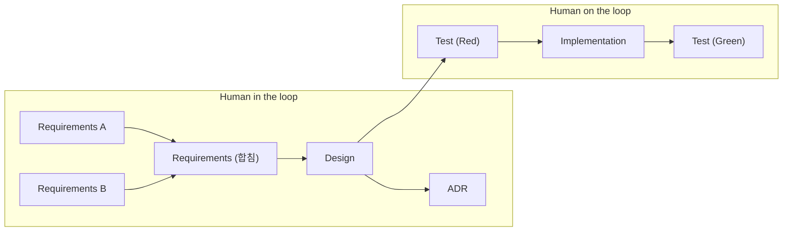
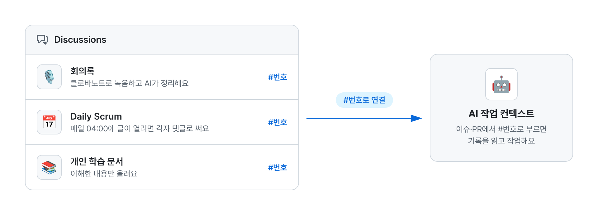
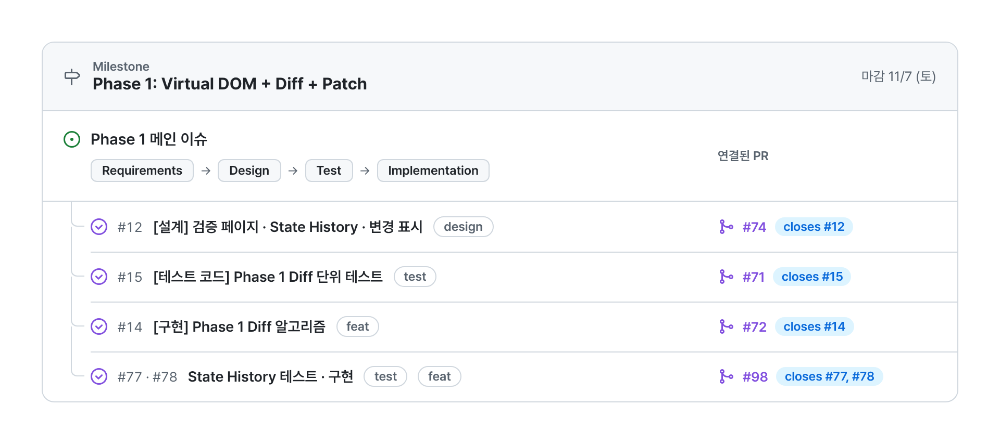

# w11-12-mini-react

Vanilla TypeScript로 Virtual DOM + Diff + Patch(Phase 1)와 Component · State · Hooks(Phase 2)를 직접 구현한 미니 리액트예요.

이 문서를 읽으면 우리 팀이 사람과 AI가 어떻게 나눠 일하는지, 그리고 AI가 팀의 작업 흐름을 따라오도록 어떤 기록을 남기는지 알 수 있어요.

## 브랜치

- `main`: 머지된 최신 코드와 문서
- `gh-pages`: [검증 페이지](https://krafton-jungle-week11-12-team.github.io/mini-react/) 배포용 빌드
- `archive/stack-traversal`: 트리를 반복문과 스택으로 순회하던 때의 기록 ([ADR-003](docs/adr/ADR-003.md))
- `archive/main-before-keyed`: key Diff([ADR-011](docs/adr/ADR-011.md))를 넣기 전의 `main`

## 목차

1. [워크플로우](#1-워크플로우)
2. [기록: AI에게 주는 컨텍스트](#2-기록-ai에게-주는-컨텍스트)
3. [자동화: Commands](#3-자동화-commands)
4. [앞으로 개선하고 싶은 점](#4-앞으로-개선하고-싶은-점)

---

## 1. 워크플로우

### 단계

한 Phase는 요구사항 → 설계 → 테스트 → 구현 순서로 진행해요. 요구사항은 각자 따로 쓴 뒤 하나로 합치고, 설계 중에 내린 결정은 ADR로 남겨요. 구현은 먼저 실패하는 테스트(Red)를 쓴 뒤 그 테스트를 통과(Green)시키는 방식으로 해요.

| 단계 | 사람의 역할 | 산출물 위치 |
| ---- | ----------- | ----------- |
| Requirements | 각자 과제를 읽고 요구사항을 따로 쓴 뒤(Requirements A, B), 함께 비교해 하나로 합쳐요. | `docs/requirements/` |
| Design | AI와 함께 쓰고, 사람이 판단·승인해요. | `docs/design/` |
| ADR | 선택지를 비교하고 사람이 결정해요. | `docs/adr/` |
| Test (Red) | AI가 쓰고, 사람은 PR에서 검토해요. | `src/**/*.test.ts` |
| Implementation → Test (Green) | AI가 테스트를 통과시키고, 사람은 PR에서 검토한 뒤 머지해요. | `src/` |

- **Human in the loop**: 단계마다 사람이 직접 판단하고 승인해야 다음 단계로 넘어가요. 무엇을 만들지 정하는 앞 단계예요.
- **Human on the loop**: AI가 알아서 진행하고, 사람은 결과를 지켜보다가 문제가 있을 때 개입해요. 요구사항과 설계가 정해진 뒤의 테스트와 구현이 여기에 해당해요.

### 분업 방식

모든 기능이 엔진 위에서 동작해서, 엔진은 함께 만들고 그 위의 웹 페이지는 나눠 만들어요. 엔진을 함께 만들면 누구든 다른 사람의 코드를 리뷰하고 고칠 수 있어요.

| 대상 | 방식 | 이유 |
| ---- | ---- | ---- |
| 엔진 (Virtual DOM, Diff, Patch, Hooks) | 함께 개발 | 모두가 핵심 로직을 이해해야 서비스 이해도가 높아지고, 서로의 코드를 리뷰할 수 있어요. |
| 웹 페이지 | 분업 | 엔진 위에서 각자 맡은 화면을 만들어 결과물을 빨리 완성해요. |

---

## 2. 기록: AI에게 주는 컨텍스트

1번 워크플로우에서 AI가 사람의 작업 흐름과 최대한 맞춰 일하려면, 팀이 무엇을 이야기하고 정했는지 AI도 알아야 해요. 그래서 아래 기록을 GitHub에 남겨요. AI에게는 일종의 학습 자료예요.

아래 기록은 모두 GitHub에서 `#번호`로 가리킬 수 있어요. 이슈, PR, Discussion에서 `#번호`로 연결해 두면 AI가 그 기록을 따라 읽고 작업의 컨텍스트로 써요.

### 2-1. Discussions

팀의 대화와 학습은 Discussions에 모아요.

- **회의록**: 회의를 클로바노트로 녹음하고, AI가 정리한 내용을 올려요.
- **Daily Scrum**: 매일 04:00(KST)에 `daily-scrum.yml`이 글을 열면, 각자 어제 한 일 · 오늘 할 일 · 막힌 점을 댓글로 직접 써요.
- **개인 학습 문서**: 각자 학습한 내용을 올려요. 이해한 내용만 올리는 것이 규칙이에요.

### 2-2. 이슈 관리: Issue + Milestone + PR

작업은 마일스톤 → 메인 이슈 → 하위 이슈 → PR 순서로 묶여요.

- **마일스톤**: Phase 하나를 마감일과 함께 묶어요.
- **메인 이슈**: Phase마다 하나씩 만들고, 1번 워크플로우 단계대로 진행 상황을 봐요.
- **하위 이슈**: 모듈 단위로 나누고, 라벨(`design`, `test`, `feat` 등)로 종류를 표시해요.
- **PR**: 본문에 `closes #번호`를 적어 하위 이슈와 연결해요. 머지되면 이슈가 자동으로 닫혀요.

### 2-3. 리뷰 봇

GitHub Claude App이 Discussions, Issues, PR 댓글에서 리뷰와 피드백을 남겨요.

| 워크플로 | 실행 시점 | 하는 일 |
| -------- | --------- | ------- |
| `claude-docs-review.yml` | 문서(`.md`)가 바뀐 PR이 열릴 때 | [테크니컬 라이팅 원칙](docs/technical-writing-principles.md)을 기준으로 판단 이유와 수정 초안을 인라인 코멘트로 남겨요. |
| `claude-code-review.yml` | PR이 열리거나 커밋이 추가될 때 | 코드 리뷰 코멘트를 남겨요. |
| `claude-discussions.yml` | Discussion 본문이나 댓글에서 `@claude`를 부를 때 | 레포 문서를 근거로 답글을 달아요. |
| `claude.yml` | 이슈나 PR에서 `@claude`를 부를 때 | 요청대로 작업하거나 답해요. 언급한 Discussion도 읽어요. |

리뷰 봇의 피드백은 사람이 함께 확인하고, 반영할지는 사람이 정해요.

---

## 3. 자동화: Commands

---

## 4. 앞으로 개선하고 싶은 점

1. **모듈화와 서브 에이전트로 병렬 작업**: 모듈을 서로 영향을 주지 않게 나눠, 사람끼리 분업하기 쉽게 만들어요. 나눈 모듈은 서브 에이전트에 하나씩 맡겨 동시에 진행해서 속도를 높여요.
2. **리뷰 봇 기능 추가**
   - PR이 닫는 이슈(`closes #번호`) 확인
   - PR 머지 순서 안내
   - 작성자가 내용을 이해했는지 질문
