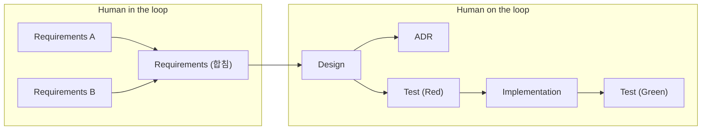

# w11-12-mini-react

Vanilla TypeScript로 Virtual DOM + Diff + Patch(Phase 1)와 Component · State · Hooks(Phase 2)를 직접 구현한 미니 리액트예요.

이 문서를 읽으면 우리 팀이 사람과 AI가 어떻게 나눠 일하는지, 그리고 AI가 팀의 작업 흐름을 따라오도록 어떤 기록을 남기는지 알 수 있어요.

## 1. AI 협업 워크플로우

| 단계                     | 역할                                                                 | 산출물 위치          |
| ------------------------ | -------------------------------------------------------------------- | -------------------- |
| Requirements A, B        | 사람이 각자 과제를 읽고 요구사항을 따로 써요.                         | `docs/requirements/` |
| Requirements (합침)      | 사람이 두 요구사항을 함께 비교해 하나로 합쳐요.                       | `docs/requirements/` |
| Design                   | AI가 쓰고, 사람은 PR에서 검토해요.                                    | `docs/design/`       |
| ADR                      | AI가 선택지를 비교해 정리하고, 사람이 결정해요.                       | `docs/adr/`          |
| Test (Red)               | AI가 실패하는 테스트를 쓰고, 사람은 PR에서 검토해요.                  | `src/**/*.test.ts`   |
| Implementation           | AI가 테스트를 통과하도록 구현하고, 사람은 PR에서 검토해요.            | `src/`               |
| Test (Green)             | AI가 모든 테스트 통과를 확인하고, 사람이 검토한 뒤 머지해요.          | `src/**/*.test.ts`   |

- **Human in the loop**: 사람이 직접 쓰고 판단해야 다음 단계로 넘어가요. 무엇을 만들지 정하는 요구사항 단계예요.
- **Human on the loop**: AI가 알아서 진행하고, 사람은 결과를 지켜보다가 문제가 있을 때 개입해요. 요구사항이 정해진 뒤의 설계, ADR, 테스트, 구현이 여기에 해당해요.

---

## 2. 워크플로우 자동화

### AI 구현 자동화를 위한 스킬설계

요구사항 → 설계 문서 → 테스트 → 구현 → 최종 검증 순서로 진행되며, 각 단계를 커맨드 하나로 실행해요.

| 순서 | 커맨드              | 하는 일                                                       | 실행 위치                 |
| ---- | ------------------- | ------------------------------------------------------------- | ------------------------- |
| 1    | `/design-doc`       | 요구사항을 읽고 설계 문서 작성                                | 요구사항 → 설계           |
| 2    | `/make-testcase`    | 요구사항과 설계를 읽고 테스트 코드 작성                       | 설계 → 테스트 (Red)       |
| 3    | `/implement-tc`     | 테스트를 통과하도록 구현 (1차 구현)                           | 테스트 (Red) → 1차 구현   |
| 4    | `/implement-design` | 통과한 테스트를 지키며 설계·ADR에 맞게 구현 고치기 (2차 구현) | 1차 구현 → 2차 구현       |
| 5    | `/test-final`       | 테스트·타입 검사·빌드·문서 정합성을 확인해 최종 판정          | 2차 구현 → 최종 검증      |
| 6    | `/doc-check`        | 문서가 템플릿 형식을 지키는지, 문서끼리 서로 맞는지 점검      | 한 사이클 끝난 뒤         |

---

## 3. AI 리뷰어

GitHub Claude App이 Discussions, Issues, PR 댓글에서 리뷰와 피드백을 남겨요.

| 워크플로                   | 실행 시점                                          | 하는 일                                                                                                                |
| -------------------------- | -------------------------------------------------- | ---------------------------------------------------------------------------------------------------------------------- |
| `claude-docs-review.yml` | 문서(`.md`)가 바뀐 PR이 열릴 때                  | [테크니컬 라이팅 원칙](docs/technical-writing-principles.md)을 기준으로 판단 이유와 수정 초안을 인라인 코멘트로 남겨요. |
| `claude-code-review.yml` | PR이 열리거나 커밋이 추가될 때                     | 코드 리뷰 코멘트를 남겨요.                                                                                             |
| `claude-discussions.yml` | Discussion 본문이나 댓글에서 `@claude`를 부를 때 | 레포 문서를 근거로 답글을 달아요.                                                                                      |
| `claude.yml`             | 이슈나 PR에서 `@claude`를 부를 때                | 요청대로 작업하거나 답해요. 언급한 Discussion도 읽어요.                                                                |

AI 리뷰어의 피드백은 사람이 함께 확인하고, 반영할지는 사람이 정해요.

---

## 4. AI 컨텍스트 관리

1번 워크플로우에서 AI가 사람의 작업 흐름과 최대한 맞춰 일하려면, 팀이 무엇을 이야기하고 정했는지 AI도 알아야 해요. 그래서 아래 기록을 GitHub에 남겨요. AI에게는 일종의 학습 자료예요.

아래 기록은 모두 GitHub에서 `#123` 같은 번호 링크로 가리킬 수 있어요. 이슈, PR, Discussion에 번호 링크를 남겨 두면 AI가 그 기록을 따라 읽고 작업의 컨텍스트로 써요.

팀의 대화와 학습은 Discussions에 모아요.

- **회의록**: 회의를 클로바노트로 녹음하고, AI가 정리한 내용을 올려요.
- **Daily Scrum**: 매일 04:00(KST)에 `daily-scrum.yml`이 글을 열면, 각자 어제 한 일 · 오늘 할 일 · 막힌 점을 댓글로 직접 써요.
- **개인 학습 문서**: 각자 학습한 내용을 올려요. 이해한 내용만 올리는 것이 규칙이에요.

---

## 5. 앞으로 개선하고 싶은 점

1. **모듈화와 서브 에이전트로 병렬 작업**: 모듈을 서로 영향을 주지 않게 나눠, 사람끼리 분업하기 쉽게 만들어요. 나눈 모듈은 서브 에이전트에 하나씩 맡겨 동시에 진행해서 속도를 높여요.
2. **AI 스킬관리** : 처리 속도를 늦추는 스킬은 다른 스킬이 자동으로 호출하지 않고 사용자가 직접 호출하도록 바꿔 속도를 높여요.
3. **리뷰 봇 기능 추가**
   - PR이 닫는 이슈(`closes #번호`) 확인
   - PR 머지 순서 안내
   - 작성자가 내용을 이해했는지 질문
