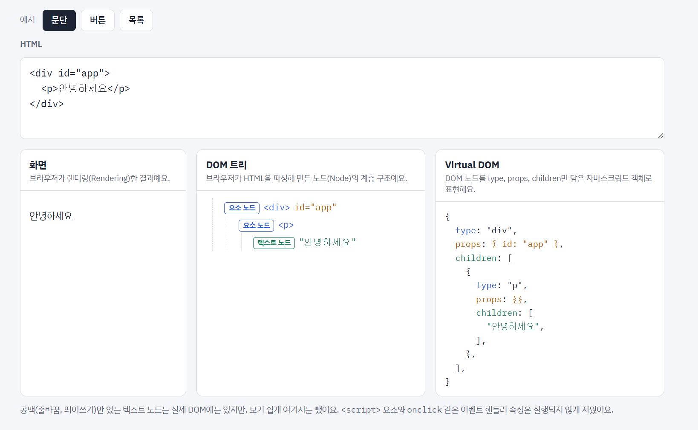
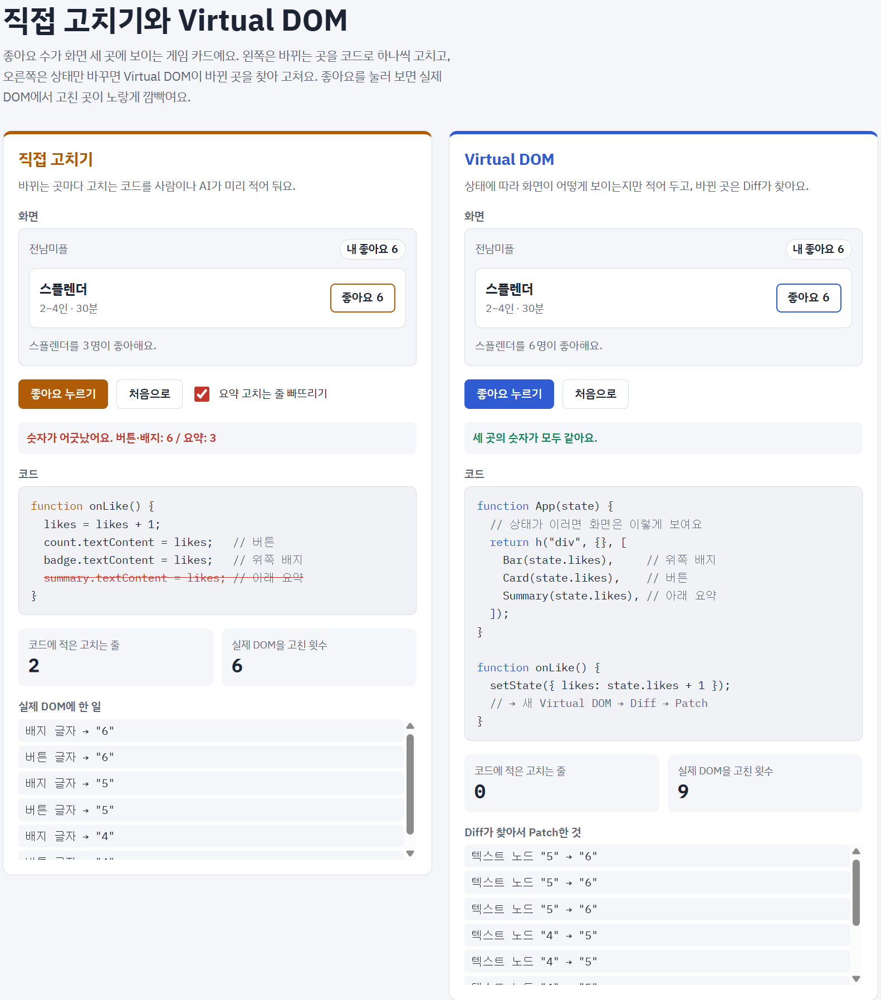
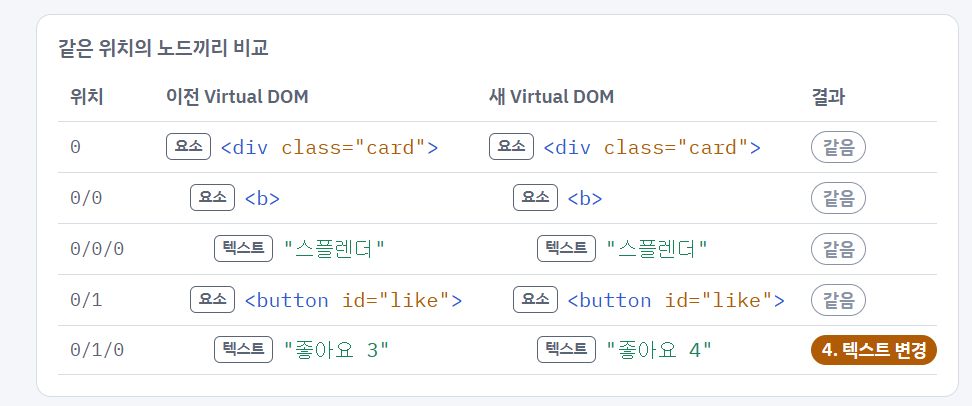

# [????? ?(??????)? ??]

## **?? ??  ****??**

| ?? | ?? |
|---|---|
| ??? | ??? |
| ??? | 2026.11.06. |
| ?? ??  | ?????? DOM? ??? ???? (Document, Window) |
| ??? | Virtual DOM,Document, Window  |

## **?? ??  ****??**

[? ??? ? ?? ?? ??? ? ??? ?? ?? ?? ???.]

- [?? 1]

- [?? 2]

## **?? ??**

### Q1. [DOM?? ?????]

[HTML? ??? ??? ??? ????? ??, ??, ???? ???? ??? ]

### Q2. [VIRTUAL DOM? ??? ??? ???]

[??? ?? ?? ???? ??? ?????? ??? ??? ????? ????, **DOM? ????? ??? ??? ??? ??? ????(reflow)?? ?? ???(repaint)??? ??? ??**??. ??? ??? ??? **? ??? ?? ??? ?? ????? ****??(diff)****? ????? ?? ?? ??**??. ? ??? ?????? ??? ???? ???? ?? ?? ??? ??? ?? ???? ??? ??? ??? ???? ???? ???? ???? ??? ??? ??? ??.** ??? ?? ??? ???? ???? ??? ?? ??? ??? ??**?? ???.]

### Q3. [????? ?? ??? ???]

[????? ??, ????? ?? ?????, ??? ?? ??? HTML, CSS, ??????? ????, **??? ???? ???? HTML?  CSS? ??**?? ??? ??, **?????? ???? ??????? ???? ?? ?? ??? ??? ??**?]

### Q4. [AI??? virtual dom? ??? ??? ????]

[? ??? ?? ???, AI? ????? ?? ??? ??? ? ?? ?? Virtual DOM??? ?? ??? ??? ?? ??? ??? ?? ??? ? ?? ??? ?? ?? ????.

??? ? ??? ?? ????. **Svelte**? ?? ??? ????? ?? ??? ??? ??? ?? ????, **SolidJS**? **???(Signal)**? ??? DOM ??? ?? ??? Virtual DOM ?? ??? ??? ????. AI? ?? ?? ??? ???? ?? ? ????? ??? AI? ?? ?? ??.

??? ??? ??. AI? ??? ???? ???? ?????, ??? ?? ?? ??? ??? ?? ???. ???** ?? ?? ??? ?? ?? ??? ?? ???? ???? ??, ??? ????? ??? ??? ?? ???? ?????.** ?? AI? ??? ??? ????? ?????? ??? ??? ??? ? ??. ?? Virtual DOM?? ????? ??? ?? ????? ?? ??? ?? ?? ??? ??. ??? ?? ??? ?? ?? ??? ?? ???? ?? ??? ???.

?? ? ??? ??? ?? ??? ??? ??????(Trade-off)?. ?? ???? ??? ?? ???? ??? ??? ??, Virtual DOM? ?? ??? ??? ??? ?? ??? ?? ??? ???? ??. AI? ???? **?? ?? ??? ?? ???**, **?? ??? ??? ?? ???? ??? ??? ???? ?? ????? ???.**]

### Q5. [AI??? virtual dom? ??? ??? ????]

[? ??? ?? ???, AI? ????? ?? ??? ??? ? ?? ?? Virtual DOM??? ?? ??? ??? ?? ??? ??? ?? ??? ? ?? ??? ?? ?? ????.

??? ? ??? ?? ????. **Svelte**? ?? ??? ????? ?? ??? ??? ??? ?? ????, **SolidJS**? **???(Signal)**? ??? DOM ??? ?? ??? Virtual DOM ?? ??? ??? ????. AI? ?? ?? ??? ???? ?? ? ????? ??? AI? ?? ?? ??.

??? ??? ??. AI? ??? ???? ???? ?????, ??? ?? ?? ??? ??? ?? ???. ???** ?? ?? ??? ?? ?? ??? ?? ???? ???? ??, ??? ????? ??? ??? ?? ???? ?????.** ?? AI? ??? ??? ????? ?????? ??? ??? ??? ? ??. ?? Virtual DOM?? ????? ??? ?? ????? ?? ??? ?? ?? ??? ??. ??? ?? ??? ?? ?? ??? ?? ???? ?? ??? ???.

?? ? ??? ??? ?? ??? ??? ??????(Trade-off)?. ?? ???? ??? ?? ???? ??? ??? ??, Virtual DOM? ?? ??? ??? ??? ?? ??? ?? ??? ???? ??. AI? ???? **?? ?? ??? ?? ???**, **?? ??? ??? ?? ???? ??? ??? ???? ?? ????? ???.**]

### Q6. [Window? Document? ???]

[Window? ????? ???? ?(?) ??? ???? ?????? ??? ?? ??? (????, ????, ? ??, ???, ??? ??) ???. Document ?? ??? ?? ??? HTML ??? ???? DOM ??? ?? ???. ]

### Q7. [HTML? Document? ????]

[HTML ??? ???? ?? ??? ?? ?? ???. **????? ?? ??? **`document`**? ?? ??? ?? DOM ??? ???**, ???? ??????? DOM ??? ??? ??? ???.  ]

## 
## **?? / ??**

1. DOM? ??????? Virtual DOM? ??

## 
2. DIFF ???? ????

## `function ``diff(parent, oldNode, newNode, index) {`
## ` ``if ``(oldNode === ``undefined``) ``return ``append(newNode);  ``// 1. ??`
## ` ``if ``(newNode === ``undefined``) ``return ``remove(index);  ``// 2. ??`
## ` ``if ``(isText(oldNode) || isText(newNode)) {`
## `   ``if ``(oldNode === newNode) ``return``;  ``// ??`
## `   ``if ``(isText(oldNode) && isText(newNode)) ``return ``setText(newNode);  ``// 4. ??? ??`
## `   ``return ``replace(newNode);  ``// 3. ??`
## ` ``}`
## ` ``if ``(oldNode.type !== newNode.type) ``return ``replace(newNode);  ``// 3. ??`
## ` ``updateProps(dom, oldNode.props, newNode.props);  ``// 5. ?? ??`
## ` ``for ``(``let ``i = ``length ``- ``1``; i >= ``0``; i--)  ``// ?? ??`
## `   ``diff(dom, oldNode.children[i], newNode.children[i], i);`
BLANK_LINE_FOUND_IN_GOOGLE_DOCS_2MD_PRO
## ??? ???? ??DOM? ????

## 
## **? ? ??  ****??**

[? ??? ? ???? ??????]

## **? ??? ?**

- [?? ??? ?, ??? ??? ?]

## **?? ??**

- [??? ?? ??]

????? ?(??????)? ??

- ?????? DOM? ??? ???? (Document, Window)

- ?? DOM? ??? ???? ?? ???? API??

- ?? DOM? ? ???? (Reflow / Repaint ??)
